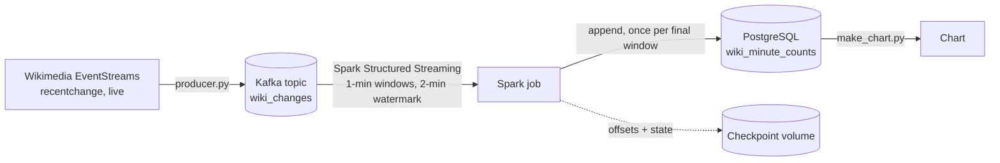
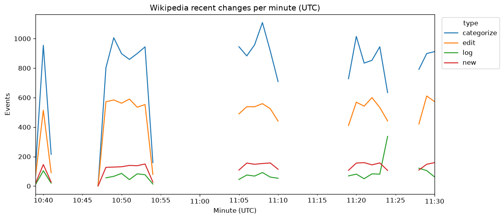

# Wikipedia Real-Time Streaming Pipeline

A real-time data pipeline built on Wikimedia's public **recent changes** stream: every edit, new page, log action and category change made on Wikipedia and its sister sites, as it happens (roughly 30 to 40 events per second in my runs). Events are published to **Apache Kafka**, aggregated into one-minute windows with **Spark Structured Streaming**, and saved to **PostgreSQL**, with a checkpoint so the job can be stopped and restarted without losing or double-counting data. Everything runs locally in Docker, at no cost.

## Architecture



| Step | What it does | Tool |
|---|---|---|
| Ingest | Reads the live stream, keeps 8 fields, sends JSON to Kafka. Reconnects if the connection drops. | Python, requests, kafka-python 3.0.11 |
| Buffer | Stores events safely, in order, and lets several readers read at their own pace | Apache Kafka 4.3.1 (single broker, KRaft, Docker Compose) |
| Process | Counts events per minute and type using **event time**, tolerating 2 minutes of lateness | Spark 3.5.9 Structured Streaming (Docker) |
| Store | One row per minute and type, saved when the window is final | PostgreSQL 16 |
| Recover | Checkpoint remembers the Kafka position and open windows | Spark checkpoint in a Docker volume |

## The data

Source: [Wikimedia EventStreams](https://stream.wikimedia.org/v2/stream/recentchange) (a Server-Sent Events feed, public, no key, a descriptive `User-Agent` is requested). Each message is a JSON object with 20+ fields. I keep eight:

| Column | Source field | Note |
|---|---|---|
| `event_id` | `meta.id` | unique, used to check for duplicates |
| `event_time` | `meta.dt` | when it happened (UTC) |
| `wiki` | `wiki` | e.g. `enwiki`, `commonswiki` |
| `type` | `type` | `edit`, `new`, `log`, `categorize` |
| `title` | `title` | page |
| `user` | `user` | editor name, or an IP address |
| `is_bot` | `bot` | bot or human |
| `byte_change` | `length.new - length.old` | only edits carry a size, so other types are `NULL`, not 0 |

In an early sample of 16,634 events: 46.9% `categorize`, 35.5% `edit`, 11.4% `log`, 6.2% `new` pages, and 51.6% were made by bots. **Only about a third of "recent changes" are real edits**, so I call the stream "changes", not "edits".

## Validation

**Data quality check** (`quality_check.py`, on 16,634 messages read back from Kafka): 16,634 unique `event_id`s (0 duplicates), 0 missing `wiki`, `type`, `title` or `user`, and every `edit` has a size.

**Kafka and Postgres reconcile.** After a run, Kafka held 32,083 messages and Postgres 27,168 events. The 4,915 difference was exactly the three windows still open when the job stopped (11:22, 11:23, 11:24: 1,680 + 1,716 + 1,519 = 4,915). Windows are saved only when they are final, so the newest 2 to 3 minutes are always missing from the table until newer events arrive.

**Restart test.** I stopped the job and started it again with no changes. It resumed at batch 31 (right after batch 30), did not re-read the history, and completed the three open windows with full counts (state restored from the checkpoint). No duplicate-key error occurred.

## Example result



- `categorize` is the largest type, then `edit`, `new` and `log`.
- **Gaps in the lines are times the producer was not running**, not zero-activity minutes.
- The dips at the start and end of each stretch are partial minutes.
- A burst of `log` events (about 340 in one minute, normally 50 to 90) shows up around 11:24 UTC. The cause is not investigated, because the table does not store the log action type.

## Design decisions

- **Event time, not arrival time.** Windows use the timestamp inside each event, so a slow or restarted job puts events in the right minute.
- **Watermark of 2 minutes.** Spark waits up to two minutes for late events, then closes the window and drops its state, so memory does not grow forever.
- **Append mode, one write per final window.** Spark does not rewrite rows that keep changing.
- **Primary key `(minute_utc, type)` as a safety net.** A replayed batch fails loudly instead of silently double-counting.
- **`NULL`, not 0, for unknown sizes.** "Unknown" and "no change" are different.
- **Reconnect loop and `finally: flush()` in the producer.** Wikimedia closes long connections now and then. The first version crashed after about 13,500 events and lost the unflushed tail.
- **Two Kafka addresses.** `localhost:9092` for programs on the host and `broker:19092` for other containers, because inside a container `localhost` means the container itself.
- **Scripts are copied into the Spark container** (`docker cp`) instead of mounting the project folder, because Docker Desktop's mount of a non-system drive on Windows failed intermittently.
- **No secrets in the repo.** The Postgres password is read from `.env` (git-ignored; see `.env.example`). No raw events are committed, because the `user` field contains IP addresses for anonymous editors.

## Run it yourself

Requires Docker and Python 3.12+.

1. Create `.env` from `.env.example` and set a password.
2. Start Kafka and Postgres:
   ```bash
   docker compose up -d
   ```
3. Create the table:
   ```bash
   docker exec wiki_postgres psql -U postgres -d wiki -c "CREATE TABLE IF NOT EXISTS wiki_minute_counts (minute_utc timestamp, type text, events bigint, PRIMARY KEY (minute_utc, type));"
   ```
4. Create a virtual environment and install the libraries: `pip install -r requirements.txt`
5. In one terminal, start the producer: `py producer.py` (Ctrl+C to stop).
6. In another terminal, start the Spark job (it stops by itself after 5 minutes): `bash run_spark_to_postgres.sh`
7. Query the results:
   ```bash
   docker exec wiki_postgres psql -U postgres -d wiki -c "SELECT * FROM wiki_minute_counts ORDER BY minute_utc, type LIMIT 20;"
   ```

## Project structure

```text
wiki-streaming-pipeline/
  docker-compose.yml        # Kafka (two listeners) + Postgres
  producer.py               # stream -> Kafka, with reconnect
  consumer.py               # plain Python consumer: counts by type and wiki
  quality_check.py          # duplicates, missing values, time range
  windows.py                # one-minute windows in plain Python
  spark_windows.py          # same windows in Spark, batch read
  spark_stream.py           # live Spark stream to the console
  spark_to_postgres.py      # live Spark stream to Postgres, with checkpoint
  run_spark_*.sh            # run each Spark job in Docker
  make_chart.py             # Postgres export -> chart
  peek_stream.py            # prints 10 cleaned events
  requirements.txt
  .env.example
```

## Known limitations and next steps

- **Events are missed while reconnecting** (about 5 seconds). Wikimedia supports resuming from the last event ID, which I did not implement.
- **At-least-once, not exactly-once.** A crash between writing to Postgres and saving the checkpoint would replay a batch. The primary key makes that fail loudly. A proper fix is an upsert.
- **Single Kafka broker, one partition, Spark in local mode.** This shows the concepts but does not scale or survive a broker failure.
- **The newest windows are missing until later events arrive**, by design of the watermark.
- **The producer is started by hand.** It is not a managed service, so the data has gaps whenever it is not running.
- **Log actions are not broken down**, so a spike like the one at 11:24 cannot be explained from the table.
- No orchestration, alerting or tests yet.

## Data attribution

Data: [Wikimedia EventStreams](https://wikitech.wikimedia.org/wiki/Event_Platform/EventStreams), recent changes from Wikipedia and its sister projects. Check Wikimedia's terms of use and each project's licence before reusing the data. No data is included in this repo.

Built by Zainab.
